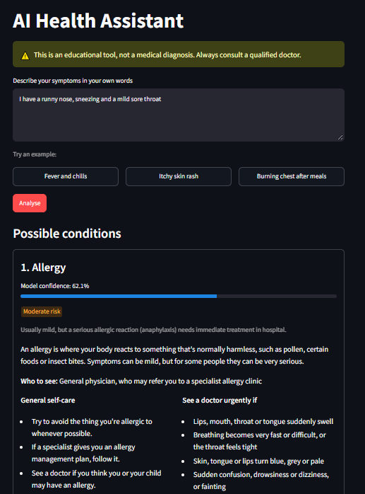
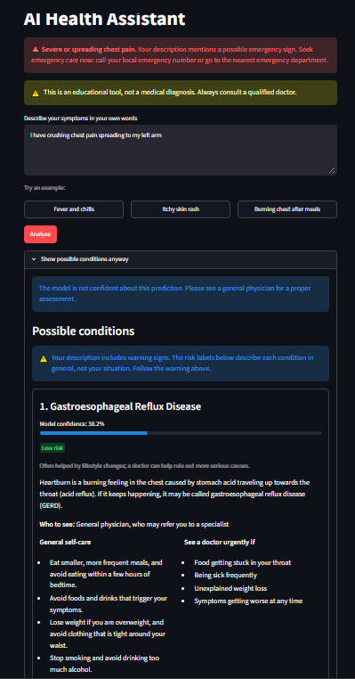
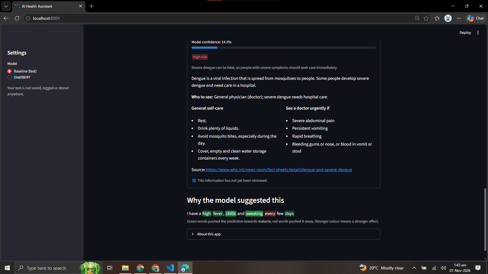

# AI Health Assistant

Describe your symptoms in plain English and get the three most likely conditions, an urgency check, general health information with sources, and the words that drove the prediction.

> **Disclaimer:** This is an educational tool, not a medical diagnosis. Always consult a qualified doctor.
> It is a portfolio project for learning NLP. It must not be used to make health decisions. In an emergency, call your local emergency number.

## Features

- **Safety checks first, with two urgency levels.** Before any model runs, the text is checked for warning signs.
  - **Emergency** (for example crushing chest pain, can't breathe, fainting, stroke signs, seizures, severe bleeding, suicidal thoughts): a red "seek emergency care now" banner, with the predictions hidden behind a collapsed section. Suicidal thoughts or self-harm also show a crisis helpline.
  - **Urgent** (for example chest tightness, shortness of breath, feeling faint, confusion): an orange "see a doctor today, or sooner if it gets worse" banner, followed by the predictions.
  - If the model is not confident (top confidence below 0.5), the app says so and recommends a general physician.
- **Top-3 predictions** with confidence bars, from one `predict()` interface that works with either model.
- **Curated disease information with sources** for all 22 conditions: a short description, which doctor to see, a risk level with a reason, general self-care tips, and warning signs. Each entry was written only from its source page on the NHS, MedlinePlus or WHO site. A validator rejects medicine doses, digits and UK-only service names.
  - **Warning signs have three levels.** Each sign keeps the level its source page gives it:

    | Level | Heading in the app | Source page wording (examples) |
    |---|---|---|
    | Emergency | "Get emergency help now if" | "Call 999", "Call 999 or go to A&E", "Go to the emergency room"; WHO "seek care immediately" (dengue) |
    | Urgent | "See a doctor urgently if" | "Urgent advice: Ask for an urgent GP appointment or get help from NHS 111", MedlinePlus "Contact your provider" |
    | Routine | "See a doctor if" | "Non-urgent advice: See a GP" |

    An entry can have signs at more than one level; for example, typhoid has three emergency signs and one urgent sign. The entry's `warning_level` is the most serious level that has any signs.
  - **Review status.** Every entry has a `reviewed` flag, and the app shows "This information has not yet been reviewed" until the owner has checked it. `python -m src.disease_info` lists the entries still waiting for review.
- **Word-level explanations.** The user's text is shown with words highlighted green (pushed towards the prediction) or red (pushed away).
- **Two models**, selectable in the sidebar: TF-IDF + Logistic Regression ("Baseline (fast)") and fine-tuned DistilBERT.
- **Privacy:** the symptom text is never saved, logged or cached. It exists only in the browser session.

## Results

All numbers come from [`reports/baseline_metrics.json`](reports/baseline_metrics.json) and [`reports/bert_metrics.json`](reports/bert_metrics.json). Settings were chosen on the validation set only, and the official test set was evaluated once per model.

| Model | Val accuracy | Val macro-F1 | Test accuracy | Test macro-F1 | Training time |
|---|---|---|---|---|---|
| TF-IDF + Logistic Regression | 0.9453 | 0.9480 | **0.9387** | **0.9392** | 0.2 s (CPU) |
| DistilBERT (`distilbert-base-uncased`) | **0.9688** | **0.9686** | 0.9292 | 0.9277 | 38.8 s (Colab GPU) |

Validation has 128 rows and test has 212.

**Conclusion: both models perform about the same on this data.**
- **Validation:** DistilBERT is ahead by 3 rows (124 vs 121 correct out of 128).
- **Test:** the baseline is ahead by 2 rows (199 vs 197 correct out of 212).
- **Why the gaps don't mean much:** they are a handful of descriptions, and both models' settings were picked on the same small validation set.
- **What this suggests:** the LLM-rewritten descriptions are clean and use consistent wording, so a simple word-based model already does very well. The baseline is also much faster and its explanations are exact, which is why it is the default in the app.

**How the settings were chosen (validation macro-F1):**
- **Baseline:** a grid of 6 settings (single words vs. word pairs, C = 0.1 / 1 / 10). Best: single words with C = 10 (0.9480). Word pairs with C = 10 scored 0.9473.
- **DistilBERT:** learning rate 5e-5 (0.9686, best epoch 6 of 8) beat 3e-5 (0.9367, best epoch 7 of 8). Other settings: batch size 16, up to 8 epochs, early stopping with patience 2, max length 128, seed 42.

Confusion matrices: [`reports/baseline_confusion_test.png`](reports/baseline_confusion_test.png) and [`reports/bert_confusion_test.png`](reports/bert_confusion_test.png). Validation matrices are in the same folder.

## Data

- **Dataset:** [`gretelai/symptom_to_diagnosis`](https://huggingface.co/datasets/gretelai/symptom_to_diagnosis) on Hugging Face.
- **Licence:** Apache 2.0.
- **Contents:** 1,065 symptom descriptions (853 train, 212 test), with one diagnosis per description out of 22 conditions.
- **Wording:** the descriptions were rewritten by an LLM to sound like patients, so the wording is cleaner and more consistent than real patient text.

**Cleaning and leakage removal** ([`reports/data_summary.json`](reports/data_summary.json)):
- 4 duplicate texts were removed from the official train set.
- 1 train text that also appeared in the test set was removed, so the model never trains on a test example.
- The official train set went from 853 to 848 rows.
- After cleaning there are no duplicates within any split and no shared texts between train, validation and test.

**Splits:** the cleaned train set was split into train and validation, stratified by label, with a fixed random seed (42). The official test set is kept untouched.

| Split | Rows | Rows per condition (min–max) |
|---|---|---|
| Train | 720 | 26–34 |
| Validation | 128 | 4–6 |
| Test (official) | 212 | 7–10 |

The classes are close to balanced: the largest class has 1.31× as many training rows as the smallest. Descriptions average about 29 words. The label distribution plot is [`reports/label_distribution.png`](reports/label_distribution.png).

## Error analysis

The most-confused pairs on the **test set** (true → predicted):

| Baseline | Count | DistilBERT | Count |
|---|---|---|---|
| peptic ulcer disease → gastroesophageal reflux disease | 3 | allergy → common cold | 3 |
| dengue → typhoid | 2 | chicken pox → dengue | 1 |
| chicken pox → bronchial asthma | 1 | chicken pox → typhoid | 1 |
| chicken pox → impetigo | 1 | common cold → pneumonia | 1 |
| diabetes → urinary tract infection | 1 | dengue → cervical spondylosis | 1 |
| gastroesophageal reflux disease → allergy | 1 | drug reaction → peptic ulcer disease | 1 |

**Lowest test F1 per condition:**
- **Baseline:** gastroesophageal reflux disease (0.762), peptic ulcer disease (0.778), typhoid (0.800)
- **DistilBERT:** common cold (0.818), allergy (0.824), jaundice (0.833)

The two models make different mistakes, and most mistakes are between conditions that really do share symptoms:
- **Baseline:** confuses the two stomach conditions (both involve burning pain, burping and indigestion) and fevers with similar symptoms (dengue vs. typhoid).
- **DistilBERT:** mixes up the two conditions with sneezing and a runny nose (allergy vs. common cold).

On validation, every confused pair appeared only once for both models.

## Known limitations

- **LLM-rewritten text.** The descriptions were rewritten by an LLM to sound like patients. Real patient text is messier (typos, slang, several problems at once), so **results on real patients would very likely be lower** than the numbers above.
- **Unseen words.** The baseline only knows words from the training data. For example, "wheezing" is in its vocabulary (and linked mostly to allergy), but **"wheeze" is not, so it is silently ignored**. DistilBERT's sub-word tokenizer handles new words better, but it was still only trained on this dataset's wording.
- **The baseline relies on filler words.**
  - "get" is among the ten words most linked to diabetes.
  - For "I get a burning feeling in my throat after eating and I burp a lot", the words "in" (+0.55) and "get" (+0.31) push towards reflux more than some symptom words.
  - These are patterns in how the LLM phrased each condition, not medical knowledge.
- **Leave-one-word-out explanations (DistilBERT) are approximate.**
  - Removing a word can break the grammar, and the model reacts to the broken sentence as well as to the missing symptom.
  - Words that only matter together (for example "chest" + "pain") can each look unimportant.
  - Each score is a change in probability, so the scores don't add up to the prediction. The baseline's scores, by contrast, add up exactly to its raw score (log-odds).
  - Common filler words are hidden from the DistilBERT explanation for readability. Their scores are unchanged, just not shown.
- **Small validation set.** The validation set has only 128 rows (4–6 per condition), so one row changes accuracy by about 0.8 percentage points. Model and setting choices made on it are noisy.
- **Red flags give false alarms, by design.**
  - The safety check is simple phrase matching. It does not understand negation, so "no chest pain" still triggers a warning: missing a real emergency is worse than a false alarm.
  - It can also misfire on wording such as "I can't breathe through my nose".
  - On the full dataset (1,065 rows), 17 rows trigger an emergency message and 184 an urgent one. These are mostly asthma, pneumonia and hypertension descriptions.
- **Only 22 conditions.** Anything else is forced into one of them.
- **Disease information is general.** It comes from public health websites and is not personal medical advice.
  - **Review status:** 13 of the 22 entries have been reviewed by the owner.
  - **Waiting for review:** 9 entries are marked `"reviewed": false` because their warning signs were regrouped into the emergency / urgent / routine levels. They are dengue, fungal infection, gastroesophageal reflux disease, hypertension, impetigo, psoriasis, typhoid, urinary tract infection and varicose veins.
  - **Risk labels are general.** The risk level on each condition describes the condition in general, not the user's situation. When the user's text contains warning signs, the app says so above the condition cards.

## Screenshots

| Normal result | Emergency banner | Word explanation |
|---|---|---|
|  |  |  |

## How to run

Requires Python 3.11+.

```bash
# 1. Create and activate a virtual environment
python -m venv venv
venv\Scripts\activate          # Windows
# source venv/bin/activate     # macOS / Linux

# 2. Install the pinned dependencies
pip install -r requirements.txt

# 3. Load, clean and split the data (writes data/labels.json and reports/data_summary.json)
python -m src.data

# 4. Train and evaluate the baseline (writes models/baseline.joblib and reports/baseline_*)
python -m src.baseline

# 5. Start the app
streamlit run app.py
```

Command-line tools (the red-flag check runs first in both):

```bash
python -m src.predict --model baseline "I have a high fever, chills and sweating every few days"
python -m src.explain --model baseline "I have a high fever, chills and sweating every few days"
python -m src.disease_info   # validate data/disease_info.json and list unreviewed entries
```

Saved models are not in Git because they are too large. If `models/bert/` is missing, the app offers only the baseline.

## Train DistilBERT on Colab

Training on a laptop CPU is slow, so [`notebooks/train_bert_colab.ipynb`](notebooks/train_bert_colab.ipynb) trains on Colab's free GPU using the same splits and labels as the baseline.

1. Open the notebook in [Google Colab](https://colab.research.google.com/) and choose **Runtime → Change runtime type → T4 GPU**.
2. Run the cells in order. The notebook:
   - clones the repository and installs the requirements
   - runs an optional one-minute smoke test (`python -m src.bert_model --smoke`)
   - trains with learning rates 5e-5 and 3e-5 using `--skip-test`, so the test set is not touched
   - picks the winner by **validation** macro-F1
   - evaluates the winner **once** on the test set with `--test-only`, which refuses to run a second time
3. The last cell downloads `bert_results.zip`. Unzip it in the project folder so the files land in `models/bert/` and `reports/`.

To train locally instead (slow without a GPU):

```bash
python -m src.bert_model --lr 5e-5 --skip-test   # train, validation only
python -m src.bert_model --test-only             # evaluate the saved model once on test
```

## Tests

```bash
pytest
```

The tests use tiny fake models, so nothing is downloaded or trained. They cover:
- data loading and splits
- the baseline and DistilBERT code
- evaluation
- the prediction interface
- the safety checks (both urgency levels, the crisis message and the no-digits rule)
- the disease-information validator
- the explanations
- the Streamlit app, using Streamlit's `AppTest`: banners, hidden predictions, HTML escaping, and results that never store the user's text

## Project structure

```
app.py                  Streamlit UI only
src/config.py           paths, random seed, thresholds, model names, crisis helpline text
src/data.py             load the dataset, clean, split, label list
src/baseline.py         TF-IDF + Logistic Regression: grid search, train, save, load
src/bert_model.py       DistilBERT fine-tuning, save, load, test-once evaluation
src/evaluate.py         accuracy, macro-F1, per-class report, confusion matrix
src/predict.py          one predict(text) interface for either model, top 3
src/safety.py           red flags (emergency / urgent), confidence check, disclaimer
src/disease_info.py     load and validate data/disease_info.json
src/explain.py          word importance (exact for the baseline, leave-one-word-out for BERT)
src/display.py          safe HTML highlighting and test scores for the app
data/disease_info.json  curated information for the 22 conditions, with sources
notebooks/              Colab notebook for DistilBERT training
reports/                metrics JSON files and confusion matrices
tests/                  pytest tests with fake models
```
